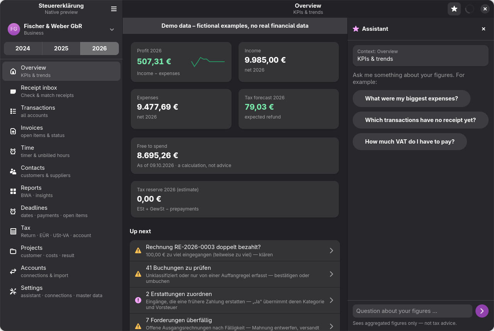
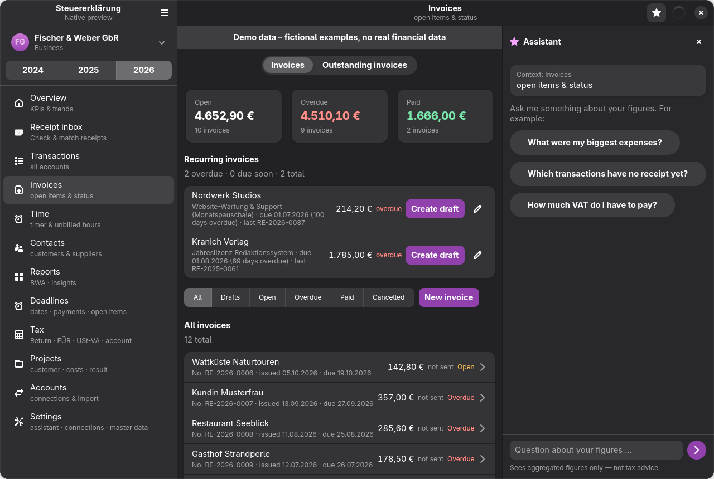
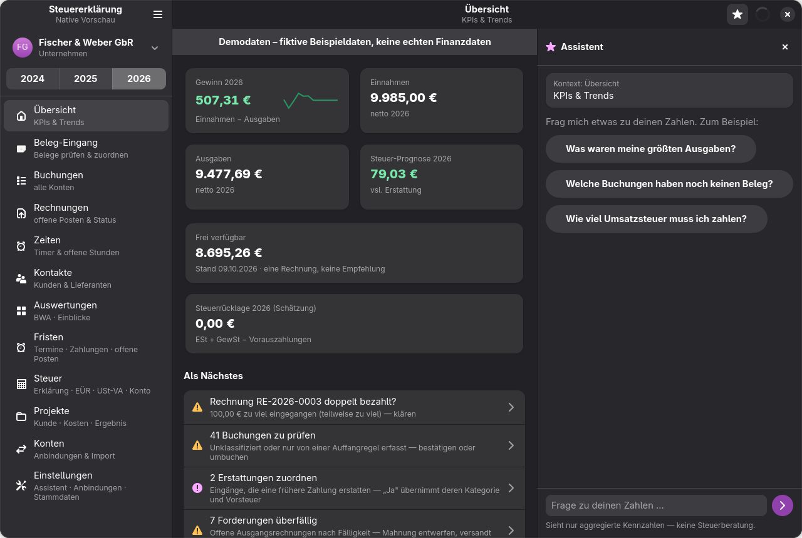

# Translation status (desktop UI)

The GNOME app is translatable with gettext. Source strings are English; German lives in
[`app/po/de.po`](../../app/po/de.po). A German-locale user sees the same German texts as before
the conversion. How to add or change a string: [CONTRIBUTING.md](../../CONTRIBUTING.md#translations).

## How the language is chosen

The app calls `setlocale(LC_ALL, "")`, so the usual order applies: `LANGUAGE`, then `LC_ALL`,
`LC_MESSAGES`, `LANG`. A `de_*` locale loads the German catalogue; any other locale shows the
English source strings. In development the catalogue comes from `app/dist/locale/`, which
`gjsify run build` compiles. The E2E scripts start the app with `LANG=de_DE.UTF-8` (override with
`E2E_LANG`), because they click by German labels.

`gjsify run check` includes `check:i18n`, which fails on a stale `.pot`, a missing, empty or fuzzy
German entry, or placeholders that differ between msgid and msgstr.

## What stays German

- **Documents.** Tax forms, ELSTER XML, return PDFs and customer invoice PDFs are not translated.
  That includes the invoice header/footer templates and the payment-reminder letter bodies
  ([`core/invoices/mahnung-text.ts`](../../app/src/core/invoices/mahnung-text.ts)): they go to a
  customer, not to the person running the app.
- **Persisted text.** Strings that are written into a config or a register and compared later —
  the filing-register note in `actions/elster/submit.ts`, the ESt intake topic titles, mail
  template placeholder names (`{betrag}`, `{kunde}`, …) — stay German wherever a translated copy
  would break an existing file.
- **Official tax terms**, also in the English UI (see the table below). Where the term is the
  official name it stays inside the English msgid: *USt-VA*, *EÜR*, *Steuerkonto*, *Zahllast*,
  *Vorsteuer*, *Feststellung*, *Säumniszuschlag*, *Sonderausgaben* and the rest of the table.
- **Developer output.** German `console.error` / `[app]` debug lines are not user-facing.
- **CLI and MCP** keep their own German literals, but they now read the core through the same
  seam as the desktop app. Neither binds a catalogue
  ([`core/lib/i18n.ts`](../../app/src/core/lib/i18n.ts) returns the msgid then), so a core string
  reaches them in English — their output is mixed until they call `setCoreTranslator`. That is
  the remaining gap, see below.

The core strings the UI used to show in German are translated now: Hinweis subtitles, "Up next"
task titles and subtitles, the reasons and origin texts of review items, the formula and hints of
"Free to spend", payment-reminder levels, form validation messages, the refund-group descriptions
and `NoticeDeadline.reason` (see [ADR 0004](../adr/0004-contracts.md)).

## Done

The desktop UI is fully English: every view, dialog and Blueprint template, plus the core strings
they display. 188 source files (162 TypeScript, 26 Blueprint), 3019 msgids — 118 with plurals, 96
with a context.

| Area | What |
|---|---|
| Shell | window, navigation, keyboard shortcuts, sync, toasts, entity switcher, glossary help, FinTS prompts, assistant panel |
| Overview | home (KPIs, Hinweise list, "Up next"), Hinweis actions, Free to spend |
| Transactions | list, detail, review queue, mark as transfer, split, rule from selection |
| Receipts | receipt inbox, open receipts, documents, upload, link receipt, metadata, document rules |
| Invoices | list, detail, form, send, payment reminder, e-invoice, recurring, receivables, double payments |
| Contracts | list, detail, form, notice deadlines, shared wording |
| Tax | EÜR, USt-VA, tax account, annexes, tax return, ESt intake wizard, cross-checks, submission arc, reports |
| Settings | top level and every subpage, accounts, ERiC, keyring, mail, classification rules |
| Projects | contacts, projects, time tracking, running costs, assets |
| Core | presenters, invoice/ELSTER actions, validation and error messages the UI shows |

The glossary ([`core/lib/glossary.ts`](../../app/src/core/lib/glossary.ts)) has an English
twin, `GLOSSARY_EN`, with the same keys; `check:glossary` enforces the parity.

A core string goes through [`core/lib/i18n.ts`](../../app/src/core/lib/i18n.ts), which a frontend
fills with its own gettext at startup. Its `_`/`_n`/`_p` must be called when the string is BUILT,
not at module level — a module-level `Record` of labels evaluates before any translator is
registered and then stays English forever. Several such constants became functions for that
reason (`invoiceStatusLabel()`, `monate()`, `mahnstufe()`, …).

Plural handling fixed a number of German grammar slips along the way: "1 Belege" is now "1 Beleg",
"seit 1 Tagen" is "seit 1 Tag", and "Rechnung(en)", "Buchung(en)", "Zahlung(en)" and "Ausnahme(n)"
now pick the right form.

## Remaining

- **CLI and MCP** still hold German literals of their own and bind no catalogue, so their output
  mixes German and English core strings. Fixing it means calling `setCoreTranslator` there and
  routing their own strings through the seam.
- **The web frontend** (`frontends/web`) has German literals outside the shared core modules.
- **Dates and numbers** are formatted German everywhere (`deDate`, `dd.mm.yyyy`, `1.234,56 €`),
  independent of the locale.

## Terminology

| German | English UI |
|---|---|
| Buchung | Transaction |
| Beleg / Beleg-Eingang | Receipt / Receipt inbox |
| Rechnung | Invoice |
| Übersicht | Overview |
| Auswertungen | Reports |
| Fristen | Deadlines |
| Abgleich (bank sync) / Abgleich (auto-matching) | Sync / Matching |
| Umbuchen / Umbuchung | Mark as transfer / Transfer |
| Frei verfügbar | Free to spend |
| Steuerrücklage | Tax reserve |
| Herleitung | Derivation |
| Festschreiben / Stornieren | Finalize / Cancel invoice |
| Mahnung | Payment reminder |
| Vorsteuer / USt | Input VAT / VAT |
| Kennzahl | Form line (Kz) |
| Querprüfung | Cross-check |
| Freigabe / Freigeben | Release |
| Prüfblatt / Prüf-PDF | Check sheet / Check PDF |
| Echt-Versand / Test-Versand | Live submission / Test submission |
| Zusammensetzung | Composition |
| Nachzahlung / Abschlusszahlung | Additional payment / final payment |
| Anlagegut / Anlageverzeichnis | Asset / asset register |
| Werbungskosten / Vorsorgeaufwendungen | Work-related expenses / Insurance contributions |
| Sonderbetriebsausgaben / Gesellschafter | Special partner expenses / Partner(s) |
| Privatanteil | Private share |
| zu versteuerndes Einkommen | Taxable income (zvE) |

Kept in German, glossed where the UI explains them: **EÜR** (cash-basis profit statement),
**USt-VA / Umsatzsteuer-Voranmeldung** (advance VAT return), **Gewerbesteuer** (trade tax),
**Kz** numbers (form line numbers), **Anlage EÜR** (EÜR form), **Steuernummer** (tax number),
**Finanzamt** (tax office), **Steuerkonto** (tax account at the Finanzamt), **Zahllast** (VAT
payable), **Säumniszuschlag** (late-payment surcharge), **Feststellung** (partnership assessment),
**Testmerker** (ELSTER test flag), **E-Rechnung** (structured e-invoice, § 14 UStG),
**Sonderausgaben** / **außergewöhnliche Belastungen** (special / extraordinary expenses).

The SKR03 account group labels and the BWA metric names (`Gesamtleistung`, `Rohertrag`,
`Betriebsergebnis`) are German labels of a German chart of accounts and stay as they are;
`GLOSSARY_EN` explains them.

## Screenshots

Demo data, English locale:

The same Overview under a German locale:

